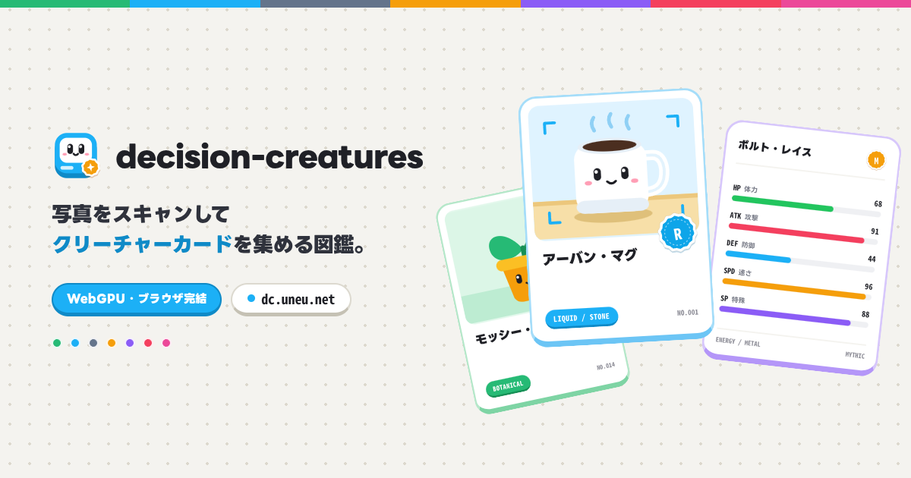

<p align="center">
  
</p>

# decision-creatures

Decision Creatures、ちぢめて **デシクリ！**

身近な写真をスキャンして、クリーチャーカードを生成・収集する **WebGPU ブラウザ完結の図鑑アプリ** です。  
画像の解析もコレクションの保存もすべてローカルのブラウザ内で完結します。

- **URL**: https://dc.uneu.net

---

## 主な特徴

- **ブラウザ完結の軽量 WebGPU 推論**: [`LiquidAI/d1-2B-ONNX`](https://huggingface.co/LiquidAI/d1-2B-ONNX) の公式 `vision_encoder_q8`（196 MB・HF CDN）と、11 設問のソフト確率分布を KL 蒸留した軽量ヘッド `creature_head.onnx`（4.85 MB・静的配信）を `onnxruntime-web/webgpu` 単体で実行（[ADR 0011](docs/adr/0011-distilled-vision-head-for-mobile-webgpu.md)）。初回ダウンロード（約 200 MB）後は OPFS からオフライン再利用でき、デスクトップだけでなく iPhone Safari 等のモバイル WebGPU でも動作します。
- **7 材質属性 × 不確実度レア度**: `BOTANICAL` / `LIQUID` / `METAL` / `STONE` / `ENERGY` / `FLESH` / `FABRIC` の 7 属性と 5 ステータス（`HP` / `ATK` / `DEF` / `SPD` / `SP`）を決定論的に算出し、モデルの判定不確実度（エントロピー）からレア度（`C` / `U` / `R` / `E` / `M`）を決定します。
- **S1 フラットポップ図鑑カード**: 3D 反転で裏面のステータスゲージを確認でき、Dexie.js（IndexedDB）にローカル保存。属性・レア度フィルタや並び替え、リネーム、表裏 2 枚並びの共有用 PNG 書き出しに対応します。
- **ライト／ダーク両対応**: クリーチャーの属性色に合わせてカードやヘッダーロゴが連動します。

---

## 技術スタック

| レイヤー | 技術 |
|---|---|
| Runtime / Build | Bun, Vite 8, React 19, TypeScript |
| UI / Styling | Tailwind CSS v4, `@base-ui/react`, `lucide-react`, Motion, LINE Seed JP |
| Routing / State | `@tanstack/react-router`, Zustand, Dexie.js (IndexedDB) |
| Inference | `LiquidAI/d1-2B` Vision (`vision_encoder_q8`) + 蒸留ヘッド (`creature_head.onnx`), `onnxruntime-web/webgpu` 専用, Web Worker |
| Hosting | Cloudflare Workers Static Assets (`cf` CLI) |

設計・意思決定の詳細は [`docs/SPEC.md`](docs/SPEC.md)・[`docs/adr/`](docs/adr/)・[`docs/TODO.md`](docs/TODO.md) を参照してください。

---

## 開発・デプロイ

Nix Flake（`nix develop` / direnv）上で Bun（およびオフライン蒸留・プロンプト生成用の `uv`）を使用します。

```bash
nix develop
bun install

# 開発サーバー起動
bun run dev

# テスト・型チェック・ビルド
bun test
bun run typecheck
bun run build

# Cloudflare Workers へ静的デプロイ
bun run deploy
```

> [!NOTE]
> スキャン機能には WebGPU 対応ブラウザ（Chrome / Edge / 対応 Safari 等）が必要です。初回スキャン時のみモデル重み（約 200 MB）をブラウザの OPFS に保存します。

---

## ライセンス・帰属表示

- **本リポジトリのソースコードおよびオリジナルアセット**: [MIT License](LICENSE)（Copyright (c) 2026 yank.nvim）
- **AI モデル重み（[`LiquidAI/d1-2B-ONNX`](https://huggingface.co/LiquidAI/d1-2B-ONNX)）**: **[LFM Open License v1.0](https://www.liquid.ai/lfm-license)**  
  `vision_encoder_q8` のモデル重みは本リポジトリに含まれておらず、実行時にユーザーのブラウザから Hugging Face 経由で取得されます。また同梱の [`public/models/creature_head.onnx`](public/models/creature_head.onnx)（4.85 MB）は `LiquidAI/d1-2B` を教師モデルとしてオフライン蒸留した軽量ヘッドです。Liquid AI 由来モデルの利用は MIT ライセンスの対象外であり、年商 1,000 万ドル（$10M USD）以上の営利組織での商用利用には Liquid AI との別途ライセンス契約が必要です。
  > Built with LiquidAI/d1-2B under LFM Open License v1.0.
- **Web フォント（[LINE Seed JP](https://seed.line.me/index_jp.html)）**: **[SIL Open Font License 1.1](https://openfontlicense.org/)**（Google Fonts 経由で読み込み）

---

Created in [T3 Code](https://t3.codes).
